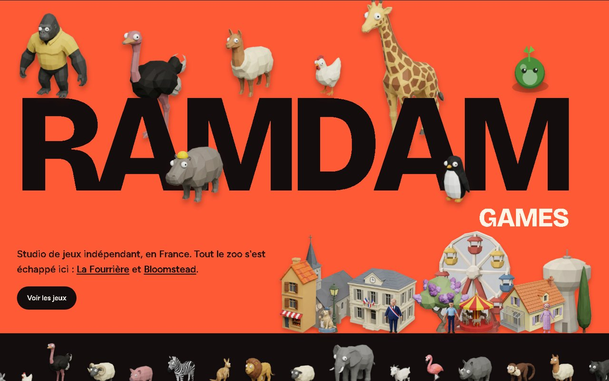
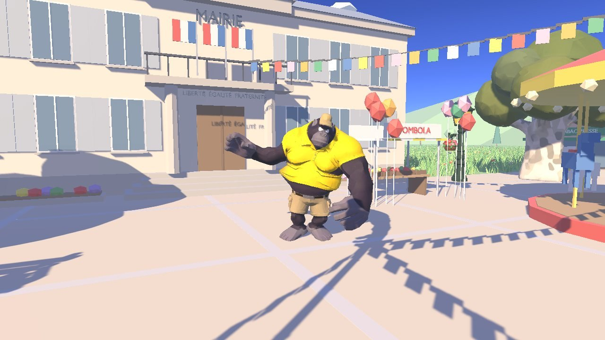
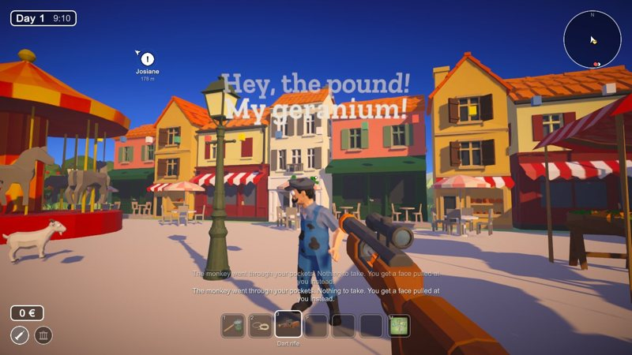
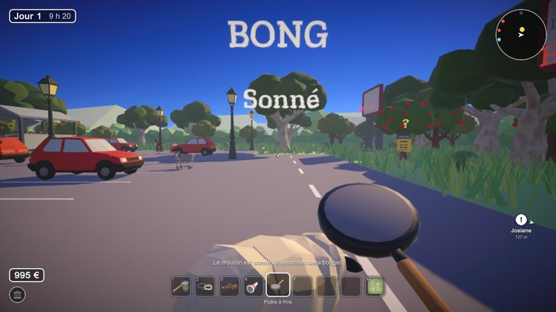
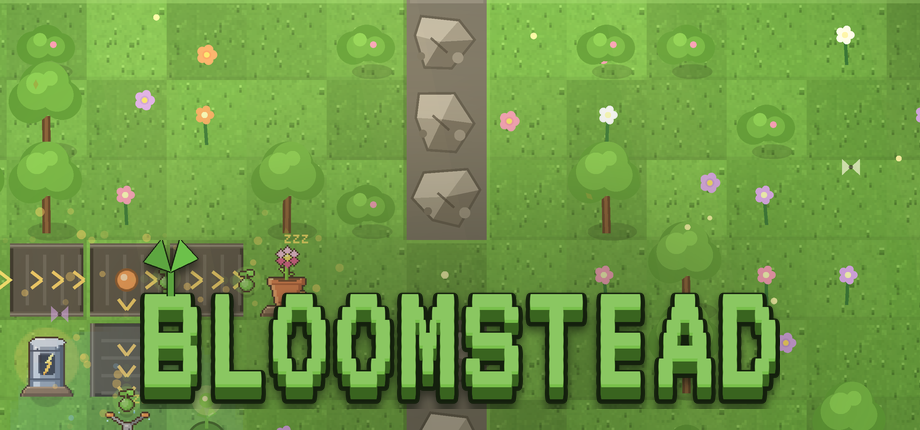
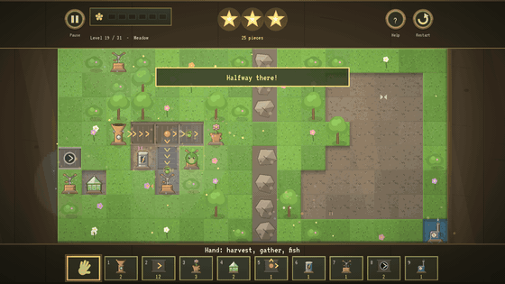

# Ramdam Games

A one-person independent game studio in France. Two games so far, each with its own page, screenshots and development journal on the website.

**Website: [ramdam-games.github.io](https://ramdam-games.github.io/)**

## La Fourrière

The municipal zoo of Poulaillac emptied during the village fair. There is a llama in the housing estate, an ostrich at the market and a gorilla on the roof of the town hall. Sentenced to community service at the pound, you catch them all, alone or with up to three friends online. You start on foot with a landing net and end up with a dart rifle, a lasso and a van held together with tape.

In development for PC, made with Unity. [Game page](https://ramdam-games.github.io/jeux/la-fourriere/) and [development journal](https://ramdam-games.github.io/jeux/la-fourriere/journal.html).

## Bloomstead

A cozy 2D automation puzzle where your factory heals the land instead of polluting it. Every level hands you a small stock of machines and a withered clearing. A piece you place stays where you put it, and the pieces you have left are your stars. Belts carry the sprouts and the world turns green again, tile by tile.

Nine machines, nine biomes, a handmade campaign followed by endless generated islands, English and French. Version 1.6.4, in preparation for PC (Steam, itch.io), Android and the browser. Made with Godot 4.

[Game page and trailer](https://ramdam-games.github.io/jeux/bloomstead/), [development journal](https://ramdam-games.github.io/jeux/bloomstead/journal.html), [privacy policy](https://ramdam-games.github.io/bloomstead-privacy/privacy.html).

---

The game repositories are private. News and release notes are published on the [website](https://ramdam-games.github.io/journal.html).
